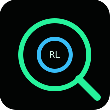
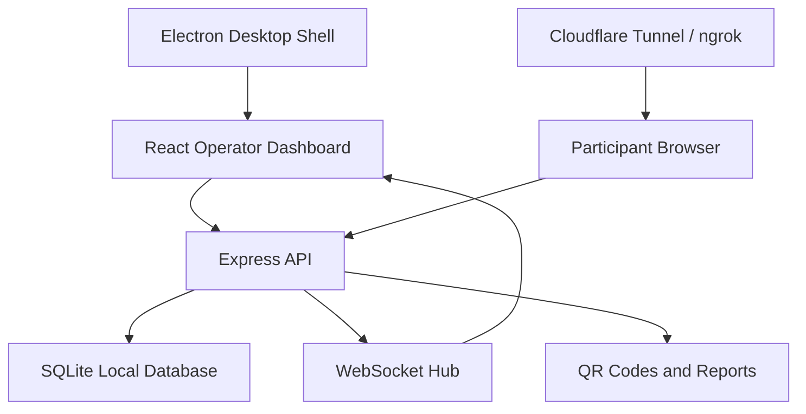
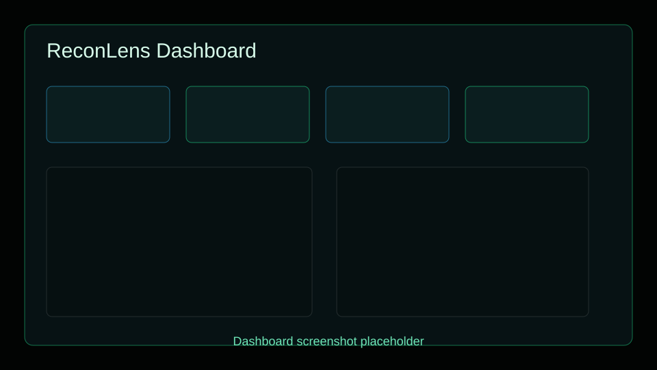
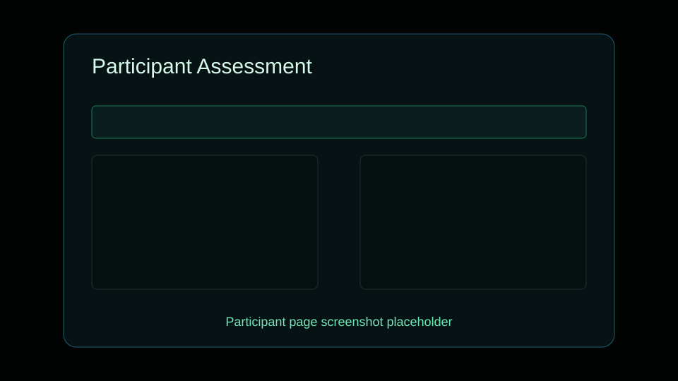
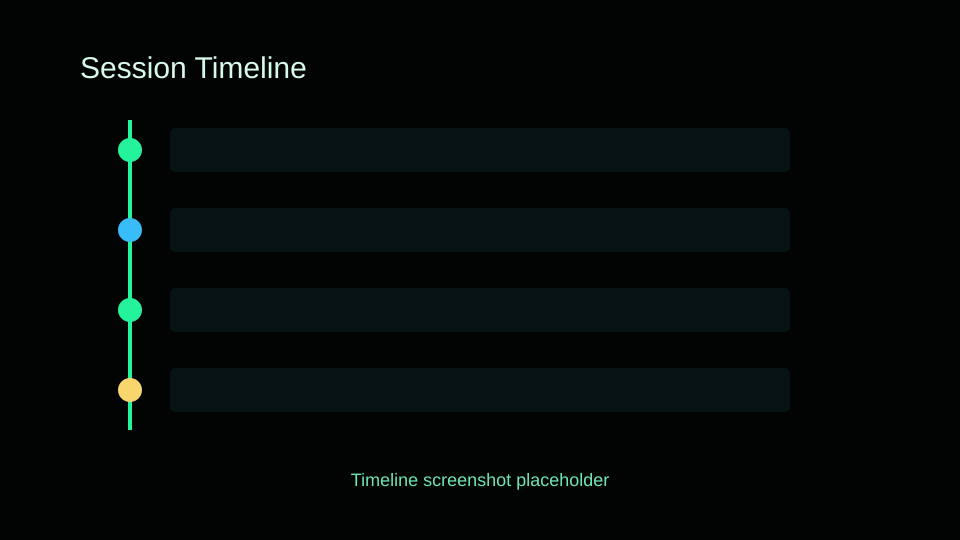
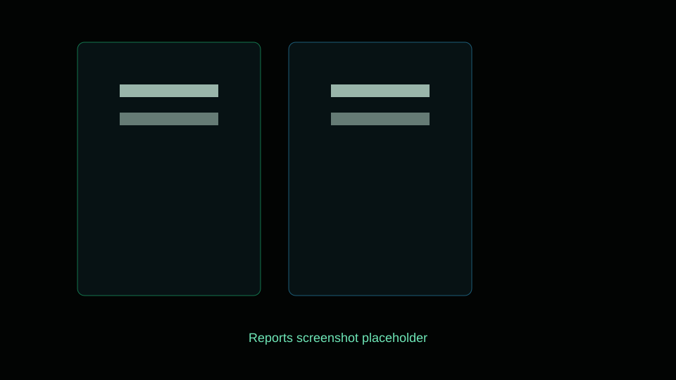
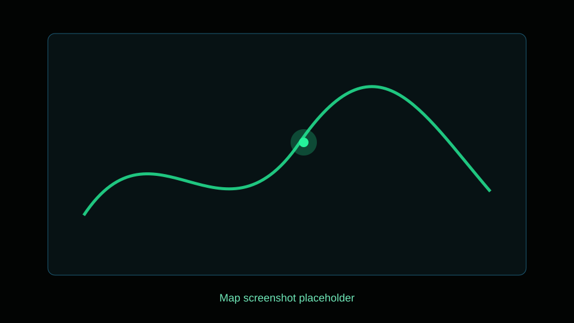
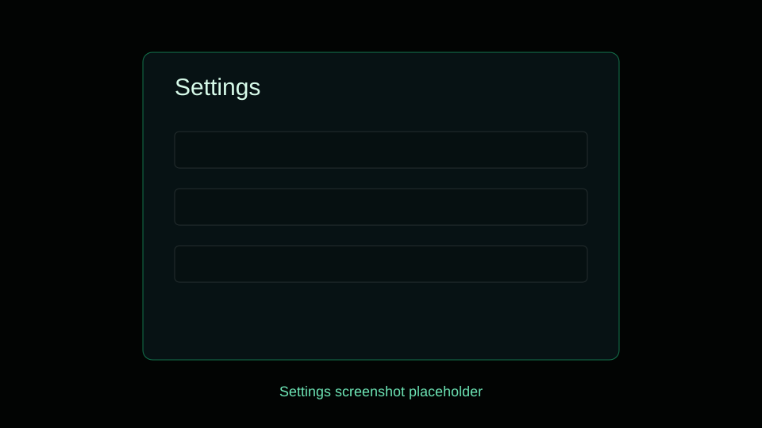

<p align="center">
  
</p>

<h1 align="center">ReconLens</h1>

<p align="center">
  <strong>See What the Web Sees.</strong>
</p>

<p align="center">
  An interactive cybersecurity awareness platform that demonstrates what websites can automatically collect from visitors and what additional information becomes available only after explicit browser permissions are granted.
</p>

<p align="center">
  <a href="LICENSE"></a>
  
  
  
  
  
</p>

---

## Overview

ReconLens is a consent-first browser privacy demonstration lab for classrooms, awareness sessions, SOC onboarding, security clubs, and public cybersecurity demos.

The operator runs a desktop dashboard. Participants scan a QR code or open a public HTTPS link generated through Cloudflare Tunnel or ngrok. ReconLens then shows, in real time, the difference between:

- data websites receive automatically during normal browsing, and
- sensitive capabilities that require explicit browser permission prompts.

The goal is education, not surveillance. ReconLens is intentionally transparent, visible, and participant-driven.

## Features

| Area | Capabilities |
| --- | --- |
| Event workflow | Event-based demonstrations, unique participant URLs, QR code generation |
| Remote access | Local mode, Cloudflare Tunnel, ngrok, public HTTPS links |
| Browser analysis | Browser family/version, operating system, device type, screen size, language, timezone |
| Network context | Public IP, approximate IP-based location, ISP, country, region |
| Permission demos | Location, camera, microphone, notifications, clipboard |
| Live dashboard | Real-time WebSocket updates, active sessions, permission statistics |
| Session timeline | Connected, automatic data collected, permission decisions, participant disconnects |
| Location view | Precise browser location with latitude, longitude, accuracy, timestamp, and Leaflet/OpenStreetMap |
| Media sharing | Participant-controlled still photo sharing after camera permission |
| Reports | PDF, CSV, and JSON exports |
| UX | Modern SOC-style dark interface with neon accents and glassmorphism |

## Architecture



## Technology Stack

| Layer | Technology |
| --- | --- |
| Desktop shell | Electron |
| Frontend | React, TypeScript, TailwindCSS, Framer Motion |
| Backend | Node.js, Express |
| Realtime | WebSocket |
| Storage | SQLite via Node.js built-in SQLite runtime |
| Reports | JSON, CSV, self-contained PDF generation |
| Maps | Leaflet + OpenStreetMap |
| Tunnels | Cloudflare Tunnel, ngrok |
| Packaging | electron-builder |

## Screenshots

Screenshots are intentionally represented as placeholders until final product captures are added.

| View | Preview |
| --- | --- |
| Dashboard |  |
| Participant Page |  |
| Timeline |  |
| Reports |  |
| Map |  |
| Settings |  |

## Installation

### Windows executable

The repository includes packaged Windows builds under `release/`.

```text
release/ReconLens 1.0.5.exe
release/ReconLens Setup 1.0.5.exe
```

These files are tracked with Git LFS because they are larger than GitHub's normal 100 MiB object limit.

```powershell
git lfs install
git clone https://github.com/anujprajapati2109/ReconLens.git
```

### From source

Requirements:

- Node.js 22+
- npm
- Windows for `.exe` packaging
- Optional: `cloudflared`
- Optional: `ngrok`

```powershell
npm install
```

## Running Locally

```powershell
npm run dev
```

Build the renderer and server bundle:

```powershell
npm run build
```

Build Windows installer and portable executable:

```powershell
npm run dist:win
```

## Deployment Using Cloudflare Tunnel

Install Cloudflare Tunnel:

```powershell
winget install --id Cloudflare.cloudflared
cloudflared --version
```

Demo flow:

1. Open ReconLens.
2. Create or open an event.
3. Select **Cloudflare Tunnel** under Deployment.
4. Click **Start Public Session**.
5. Wait for status `online`.
6. Share the public HTTPS URL or deployment QR code with consenting participants.
7. Keep ReconLens open while the demonstration is active.

Remote participants must use the Deployment HTTPS URL, not the local `localhost` URL.

## How Demonstrations Work

1. The operator creates an event.
2. ReconLens generates a participant URL and QR code.
3. A tunnel provider exposes the participant page over HTTPS.
4. Participants open the page on their own devices.
5. ReconLens records automatically available browser/network/device information.
6. Participants choose whether to grant browser permissions.
7. The dashboard updates in real time.
8. The operator exports PDF, CSV, or JSON reports for review.

## Project Structure

```text
src/
  main/                 Electron entry point
  renderer/             React desktop and participant UI
    components/         Shared UI components
    hooks/              Realtime dashboard hooks
    pages/              Home, event, dashboard, participant, settings
    utils/              API client and browser collection utilities
  server/               Express backend
    database/           SQLite schema and repository
    routes/             API routes
    services/           Export, IP info, tunnel, report services
    websocket/          WebSocket hub
  shared/               Shared TypeScript types and education copy
release/                Packaged Windows builds
docs/screenshots/       Screenshot placeholders
```

## Educational Purpose

ReconLens is designed for controlled demonstrations where participants understand the purpose of the session. It is useful for:

- cybersecurity awareness training,
- privacy workshops,
- browser security lessons,
- SOC onboarding,
- security club demonstrations,
- explaining permission prompts to non-technical audiences.

## Privacy

ReconLens separates automatic information from permission-gated information in the UI.

Automatic information may include browser version, operating system, screen size, language, timezone, public IP, and approximate IP-based location.

Permission-gated information is requested only after participant action. Camera photos are shared only after the participant clicks **Take & Share Photo** on their own device.

## Security Disclaimer

This project is designed exclusively for cybersecurity awareness and education.

It relies only on standard browser capabilities and explicit participant consent. It does not bypass browser security, exploit vulnerabilities, remotely activate hardware without consent, or enable unauthorized access.

## Roadmap

- Add signed release artifacts.
- Add automated screenshot generation for documentation.
- Add optional custom domain support for Cloudflare Tunnel.
- Add multi-event filtering and archiving.
- Add anonymized classroom mode.
- Add richer report templates.

## Contributing

Contributions are welcome if they preserve the consent-first design. See [CONTRIBUTING.md](CONTRIBUTING.md).

## License

ReconLens is released under the [MIT License](LICENSE).

## Acknowledgements

- Cloudflare Tunnel for secure temporary public URLs.
- ngrok for developer-friendly tunneling.
- OpenStreetMap contributors for map data.
- Leaflet, React, Electron, and the Node.js ecosystem.
